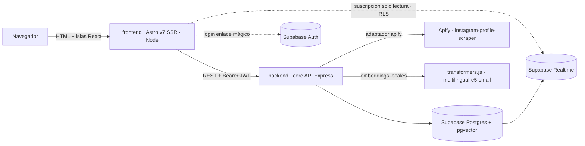

# Ficha de arquitectura

| Pieza | Decisión |
|---|---|
| Ingesta IG | [ADR-001](adr/ADR-001-ingesta-instagram.md) |
| Verificación de propiedad | [ADR-002](adr/ADR-002-verificacion-propiedad.md) |
| Clasificación y matching | [ADR-003](adr/ADR-003-clasificacion-matching.md) |
| Monorepo y contratos | [ADR-004](adr/ADR-004-monorepo-contratos.md) |
| Backend | [ADR-005](adr/ADR-005-backend-hexagonal.md) · [normativo](backend-hexagonal.md) |
| Frontend y Realtime | [ADR-006](adr/ADR-006-frontend.md) · [normativo](frontend.md) |

Flujo principal: login (enlace mágico) → reclamar @handle → código en bio → verificación (ingesta en vivo) → clasificación → feed de tarjetas → interés mutuo = match → chat y cotización → notificaciones.
